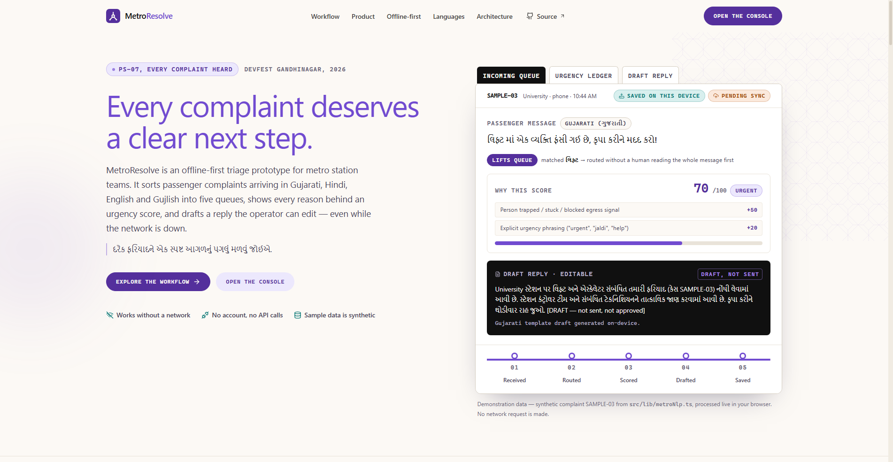
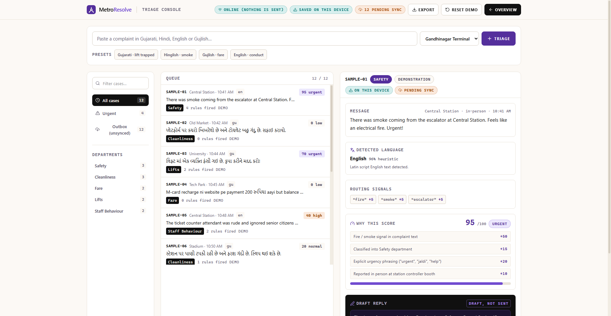

# MetroResolve

**Offline-first, multilingual complaint triage for metro station teams.**
Every complaint deserves a clear next step.

MetroResolve is an open-source prototype that takes a passenger complaint in
Gujarati, Hindi, English or code-switched Gujlish/Hinglish, routes it to one of
five queues, shows **every reason behind its urgency score**, drafts an editable
reply, and saves the record on the device — even when the network is gone.

Built for problem statement **PS-07 — "Every Complaint Heard"** at
**Metro Hacks, DevFest Gandhinagar '26**.



> **Independent prototype.** Not affiliated with, endorsed by, or connected to
> the Gujarat Metro Rail Corporation or any transit operator. All complaint
> messages bundled in this repository are **synthetic demonstration data**.

---

## Why this exists

Complaints reach a station desk through several channels, in several languages,
within the same busy hour. Sorted by hand, the pile falls into arrival order —
so a lift emergency written in Gujarati can sit beneath two notices about a
spilled drink.

MetroResolve proposes one boring, reliable pipeline instead:

```
message → detect language → route to a queue → score with visible reasons
        → draft a reply → save locally → (later) sync
```

Every stage is deterministic code you can read, not a model call.

---

## Routes

| Route            | What it is                                                        |
| ---------------- | ----------------------------------------------------------------- |
| `/` (or `#/`)    | Landing page: problem, workflow, live demo, offline story, docs   |
| `#/app`          | **The application**: triage console with queues, ledger and drafts |

The landing page links to the console from the hero, the workflow section and
the closing CTA. Deep links work on refresh (`/#/app`, `/#workflow`).



---

## What is actually implemented

| Capability | Status |
| --- | --- |
| Language detection — Unicode script ranges + romanized lexicons | ✅ Implemented (heuristic, confidence shown as-is) |
| Department routing — Safety, Cleanliness, Fare, Lifts, Staff Behaviour | ✅ Implemented (keyword-weighted, signals shown) |
| Explainable urgency scoring — 9 transparent rules, capped at 100 | ✅ Implemented (full ledger rendered) |
| Editable draft replies in the complainant's language | ✅ Implemented (templates, marked `DRAFT — not sent`) |
| Local persistence (localStorage) + JSON export | ✅ Implemented (`src/lib/store.ts`) |
| Offline triage after first page load | ✅ Implemented (verified with DevTools offline mode) |
| Real online/offline status from `navigator.onLine` | ✅ Implemented |
| Sync backend, idempotent API, conflict handling | ❌ **Not implemented** — outbox state only |
| Service worker / installable PWA | ❌ **Not implemented** — first load needs a connection |
| Trained/transformer models, machine translation | ❌ **Not used** — by design (see limitations) |

---

## Tech stack

- **React 19** + **TypeScript** — UI and engine types
- **Vite 8** — dev server and static production build
- **Tailwind CSS 4** — design tokens in `src/index.css` (no remote fonts)
- **lucide-react** — icons
- **localStorage** — the only "backend"

Notes:

- The landing page and console make **no network requests**: no API calls, no
  remote fonts, no analytics, no trackers.
- `package.json` also declares `@google/genai`, `express`, `dotenv` and
  `motion` from the original scaffolding; **nothing in `src/` imports them at
  runtime**.
- `.env.example` is scaffolding too — **no environment variables are required**
  to run the app.

---

## Getting started

Requires **Node.js 20.19+** (tested on Node 24) and npm.

```bash
npm install
npm run dev        # http://localhost:3000
```

| Script | What it does |
| --- | --- |
| `npm run dev` | Vite dev server on port 3000 |
| `npm run build` | Production bundle to `dist/` |
| `npm run preview` | Serve the production bundle (port 4173) |
| `npm run lint` | `tsc --noEmit` — type check the whole project |
| `npm run verify:samples` | Print the real engine output for all 12 bundled messages and assert the scores quoted on the landing page |

---

## Offline behaviour — and how to verify it

All triage runs in the browser, and every case is written to localStorage
immediately. There is **no sync backend**, so records carry a sync state that
stays `pending` until an operator exports them as JSON.

To verify:

1. Open the console (`#/app`) and triage a complaint — the chip reads
   *"Saved on this device"*.
2. DevTools → **Application → Local Storage** → `metroresolve.cases.v1` shows
   the record.
3. Reload the page: the case and its edited draft are still in the queue.
4. DevTools → **Network → Offline**: an offline banner appears and triage keeps
   working — nothing calls out.
5. Click **Export** to download the queue as JSON.

Honest limits: with no service worker, the app itself needs **one** connection
to load. After that, processing and storage are fully local.

---

## Architecture

```
┌──────────────────────────────────────────────────────────────┐
│ Browser tab (single static bundle)                           │
│                                                              │
│  src/site/Landing.tsx          src/console/TriageConsole.tsx │
│        │                                  │                  │
│        └────────────┬─────────────────────┘                  │
│                     ▼                                        │
│          src/lib/metroNlp.ts  (pure functions)               │
│          detect → classify → score → draft                   │
│                     │                                        │
│                     ▼                                        │
│          src/lib/store.ts                                    │
│          localStorage read/write · JSON export               │
│                     │                                        │
│                     ▼                                        │
│          metroresolve.cases.v1                               │
└──────────────────────────────────────────────────────────────┘
                     ✕  sync backend: not implemented yet
```

Key files:

| File | Role |
| --- | --- |
| `src/lib/metroNlp.ts` | Language detection, department classification, 9 urgency rules, reply templates |
| `src/lib/store.ts` | Local-first persistence (`StoredCase`, sync state, export) |
| `src/console/TriageConsole.tsx` | The working application: intake, queues, ledger, draft editor |
| `src/site/` | Landing page sections built around a metro route-line motif |
| `src/hooks/useHashRoute.ts` | Dependency-free hash routing for `#/` and `#/app` |
| `scripts/verify-samples.ts` | Engine smoke test for every bundled message |

### Design system

The visual identity is Ahmedabad-rooted and code-rendered: warm limewash
paper (`#F7F3EC`), deep indigo ink (`#15123A`), a single vermilion signal
accent (`#D9451F`), a jali lattice used as structure, and route lines that
double as section dividers. No external fonts or images — everything renders
from CSS/SVG.

---

## Current limitations

- Classification and language detection are **keyword/lexicon heuristics**, not
  ML — misclassification is possible and confidence values are ratios, not
  accuracy guarantees.
- Draft replies are **templates** (English, Hindi, Gujarati), not machine
  translation; romanised input falls back to English.
- **No sync backend**: the outbox never becomes *confirmed*; records stay in
  the browser until exported.
- **No service worker**: the first page load requires a connection.
- Bundled complaints are **synthetic** — no real passenger records.
- No automated test suite yet; verification is `npm run lint`,
  `npm run verify:samples`, and the manual offline steps above.

---

## Deployment (optional next step)

No deployment is configured in this repository. The build is a plain static
bundle, so any static host works:

```bash
npm run build      # → dist/
```

Publishing `dist/` (GitHub Pages, Netlify, Cloud Run static serving, …) is a
documented next step, not a delivered feature.

---

## Contributing

Issues and pull requests are welcome:
**<https://github.com/RavaniRoshan/mitrometro/issues>**

Good first areas: a service worker for shell caching, a real sync endpoint
behind the existing outbox state, more romanised-lexicon coverage, and
accessibility review for Gujarati/Devanagari screen readers.

Before opening a PR:

```bash
npm run lint
npm run verify:samples
npm run build
```

## Licence

No licence file has been chosen for this repository yet — add one before
redistributing.
